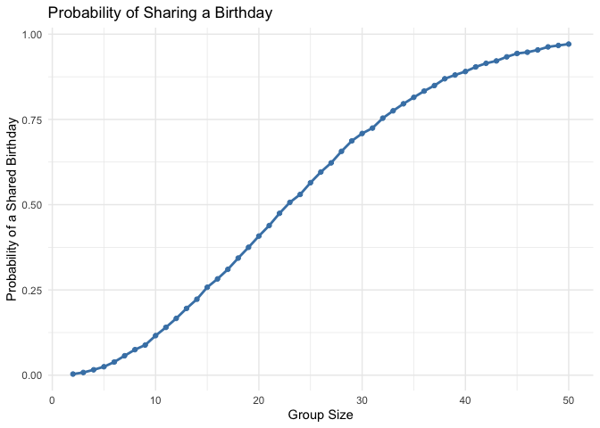
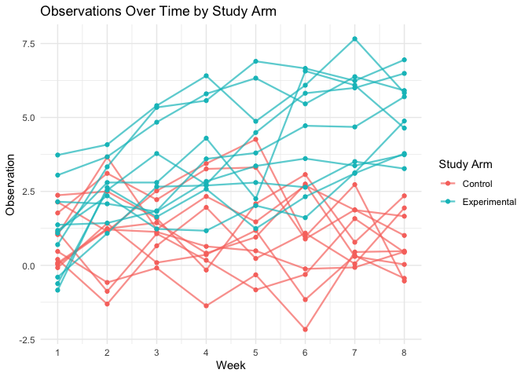
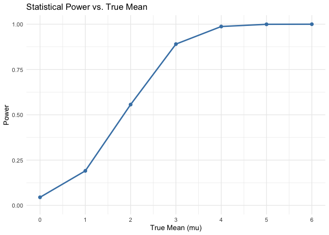
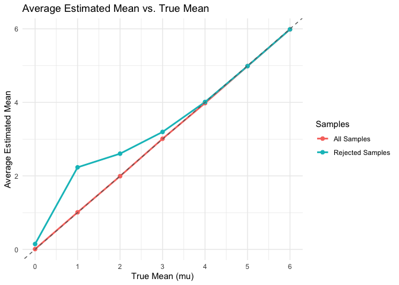

p8105_hw5_tc3609
================
Joanna Chuang
2026-11-12

# Problem 1

``` r
birthday_sim = function(n) {
  birthdays = sample(1:365, size = n, replace = TRUE)
  any(duplicated(birthdays))
}

set.seed(123)

birthday_results = tibble(
  group_size = 2:50
) |>
  mutate(
    probability = map_dbl(
      group_size,
      ~ mean(replicate(10000, birthday_sim(.x)))
    )
  )

birthday_results
```

    ## # A tibble: 49 × 2
    ##    group_size probability
    ##         <int>       <dbl>
    ##  1          2      0.0033
    ##  2          3      0.0079
    ##  3          4      0.0158
    ##  4          5      0.0248
    ##  5          6      0.0387
    ##  6          7      0.057 
    ##  7          8      0.0749
    ##  8          9      0.0885
    ##  9         10      0.116 
    ## 10         11      0.140 
    ## # ℹ 39 more rows

``` r
birthday_results |>
  ggplot(aes(x = group_size, y = probability)) +
  geom_line(color = "steelblue", linewidth = 1) +
  geom_point(color = "steelblue", size = 1.5) +
  labs(
    title = "Probability of Sharing a Birthday",
    x = "Group Size",
    y = "Probability of a Shared Birthday"
  ) +
  theme_minimal()
```

<!-- -->

The probability of sharing a birthday increases as the group size
increases. With around 23 people, the probability is already
approximately 50%. As the group reaches to 50 people, the probability is
close to 97%. This shows that shared birthdays become much more likely
as the number of people in the group increases.

# Problem 2

``` r
file_names = tibble(
  file_name = list.files(
    path = "data",
    pattern = "\\.csv$",
    full.names = TRUE,
    recursive = TRUE
  )
)

longitudinal_data = file_names |>
  mutate(
    data = map(file_name, read_csv)
  ) |>
  unnest(data) |>
  mutate(
    subject_id = str_remove(basename(file_name), ".csv$"),
    arm = if_else(
      str_detect(subject_id, "^con"),
      "Control",
      "Experimental"
    )
  ) |>
  pivot_longer(
    cols = starts_with("week_"),
    names_to = "week",
    values_to = "observation"
  ) |>
  mutate(
    week = as.numeric(str_remove(week, "week_"))
  ) |>
  select(subject_id, arm, week, observation)

longitudinal_data
```

    ## # A tibble: 160 × 4
    ##    subject_id arm      week observation
    ##    <chr>      <chr>   <dbl>       <dbl>
    ##  1 con_01     Control     1        0.2 
    ##  2 con_01     Control     2       -1.31
    ##  3 con_01     Control     3        0.66
    ##  4 con_01     Control     4        1.96
    ##  5 con_01     Control     5        0.23
    ##  6 con_01     Control     6        1.09
    ##  7 con_01     Control     7        0.05
    ##  8 con_01     Control     8        1.94
    ##  9 con_02     Control     1        1.13
    ## 10 con_02     Control     2       -0.88
    ## # ℹ 150 more rows

``` r
longitudinal_data |>
  ggplot(aes(
    x = week,
    y = observation,
    group = subject_id,
    color = arm
  )) +
  geom_line(linewidth = 0.8, alpha = 0.7) +
  geom_point(size = 1.5) +
  labs(
    title = "Observations Over Time by Study Arm",
    x = "Week",
    y = "Observation",
    color = "Study Arm"
  ) +
  scale_x_continuous(breaks = 1:8) +
  theme_minimal()
```

<!-- -->

The experimental group shows an overall increase in observations over
the eight weeks, while the control group remains relatively stable with
some individual variation. By week 8, participants in the experimental
group generally have higher observations than participants in the
control group. This suggests that the two groups follow different trends
over time.

# Problem 3

``` r
library(broom)

sim_t_test = function(mu) {

  sample_data = rnorm(
    n = 30,
    mean = mu,
    sd = 5
  )

  test_result = t.test(
    sample_data,
    mu = 0
  )

  broom::tidy(test_result) |>
    select(estimate, p.value)
}
```

``` r
set.seed(123)

sim_results = tibble(
  true_mu = rep(0:6, each = 5000)
) |>
  mutate(
    results = map(true_mu, sim_t_test)
  ) |>
  unnest(results) |>
  mutate(
    rejected = p.value < 0.05
  )

sim_results
```

    ## # A tibble: 35,000 × 4
    ##    true_mu estimate p.value rejected
    ##      <int>    <dbl>   <dbl> <lgl>   
    ##  1       0  -0.236   0.794  FALSE   
    ##  2       0   0.892   0.252  FALSE   
    ##  3       0   0.122   0.879  FALSE   
    ##  4       0  -0.469   0.575  FALSE   
    ##  5       0  -0.918   0.388  FALSE   
    ##  6       0   0.769   0.379  FALSE   
    ##  7       0   0.0735  0.934  FALSE   
    ##  8       0  -0.448   0.578  FALSE   
    ##  9       0   0.254   0.789  FALSE   
    ## 10       0   1.68    0.0483 TRUE    
    ## # ℹ 34,990 more rows

``` r
power_results = sim_results |>
  group_by(true_mu) |>
  summarize(
    power = mean(rejected),
    .groups = "drop"
  )

power_results
```

    ## # A tibble: 7 × 2
    ##   true_mu  power
    ##     <int>  <dbl>
    ## 1       0 0.0446
    ## 2       1 0.191 
    ## 3       2 0.556 
    ## 4       3 0.890 
    ## 5       4 0.987 
    ## 6       5 0.999 
    ## 7       6 1

``` r
power_results |>
  ggplot(aes(x = true_mu, y = power)) +
  geom_line(color = "steelblue", linewidth = 1) +
  geom_point(color = "steelblue", size = 2) +
  labs(
    title = "Statistical Power vs. True Mean",
    x = "True Mean (mu)",
    y = "Power"
  ) +
  scale_x_continuous(breaks = 0:6) +
  scale_y_continuous(limits = c(0, 1)) +
  theme_minimal()
```

<!-- -->

As the true mean increases, the proportion of rejected null hypotheses
also increases. When the true mean is 0, the rejection rate is around
5%, as expected. For larger values of the true mean, the test is more
likely to detect a difference from 0, so the power increases.

``` r
mean_results = sim_results |>
  group_by(true_mu) |>
  summarize(
    mean_all = mean(estimate),
    mean_rejected = mean(estimate[rejected]),
    .groups = "drop"
  )

mean_results
```

    ## # A tibble: 7 × 3
    ##   true_mu mean_all mean_rejected
    ##     <int>    <dbl>         <dbl>
    ## 1       0  0.00900         0.147
    ## 2       1  1.01            2.23 
    ## 3       2  1.99            2.60 
    ## 4       3  3.01            3.20 
    ## 5       4  3.98            4.01 
    ## 6       5  4.98            4.99 
    ## 7       6  5.99            5.99

``` r
mean_results |>
  pivot_longer(
    cols = c(mean_all, mean_rejected),
    names_to = "estimate_type",
    values_to = "average_estimate"
  ) |>
  mutate(
    estimate_type = recode(
      estimate_type,
      mean_all = "All Samples",
      mean_rejected = "Rejected Samples"
    )
  ) |>
  ggplot(aes(
    x = true_mu,
    y = average_estimate,
    color = estimate_type
  )) +
  geom_line(linewidth = 1) +
  geom_point(size = 2) +
  geom_abline(
    intercept = 0,
    slope = 1,
    linetype = "dashed",
    color = "gray40"
  ) +
  labs(
    title = "Average Estimated Mean vs. True Mean",
    x = "True Mean (mu)",
    y = "Average Estimated Mean",
    color = "Samples"
  ) +
  scale_x_continuous(breaks = 0:6) +
  theme_minimal()
```

<!-- -->

The average estimate across all simulations stays close to the true
mean. However, when we only look at samples that reject the null
hypothesis, the average estimate is higher than the true mean for
smaller positive values of μ. This is because samples with more extreme
estimates are more likely to be statistically significant. As μ
increases, the two averages become closer since more samples reject the
null hypothesis.
